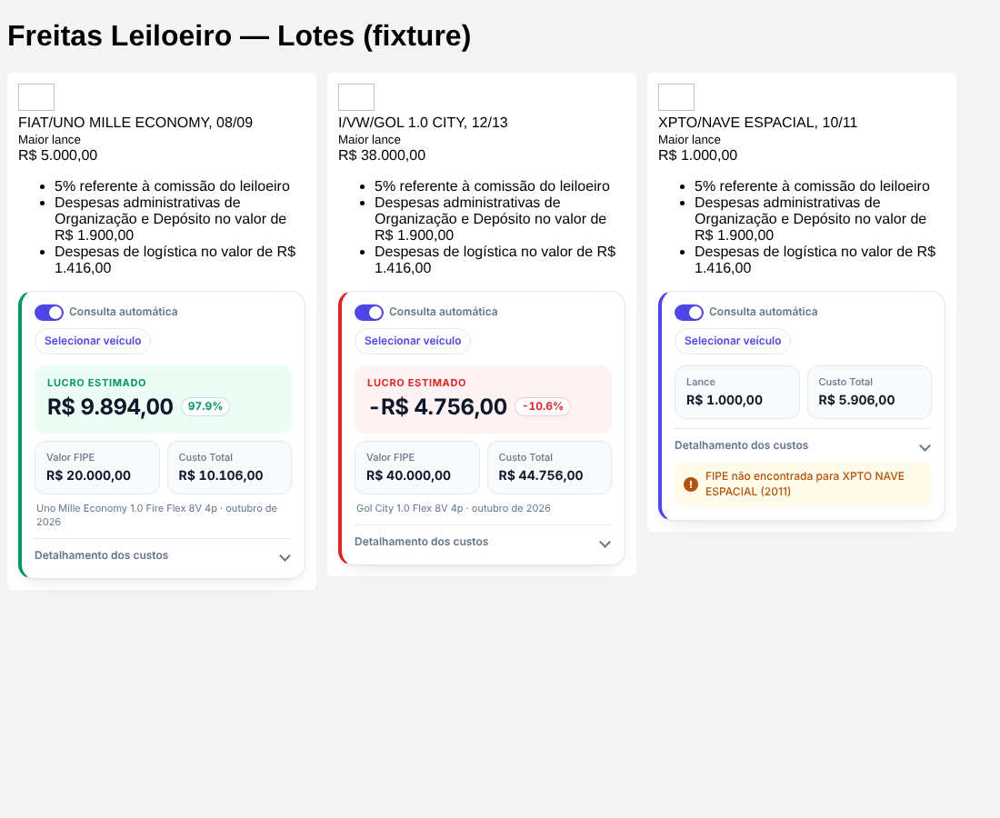
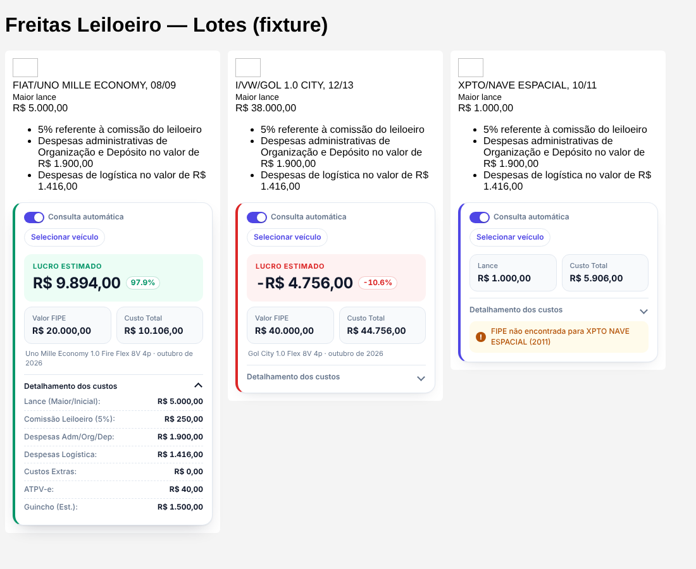
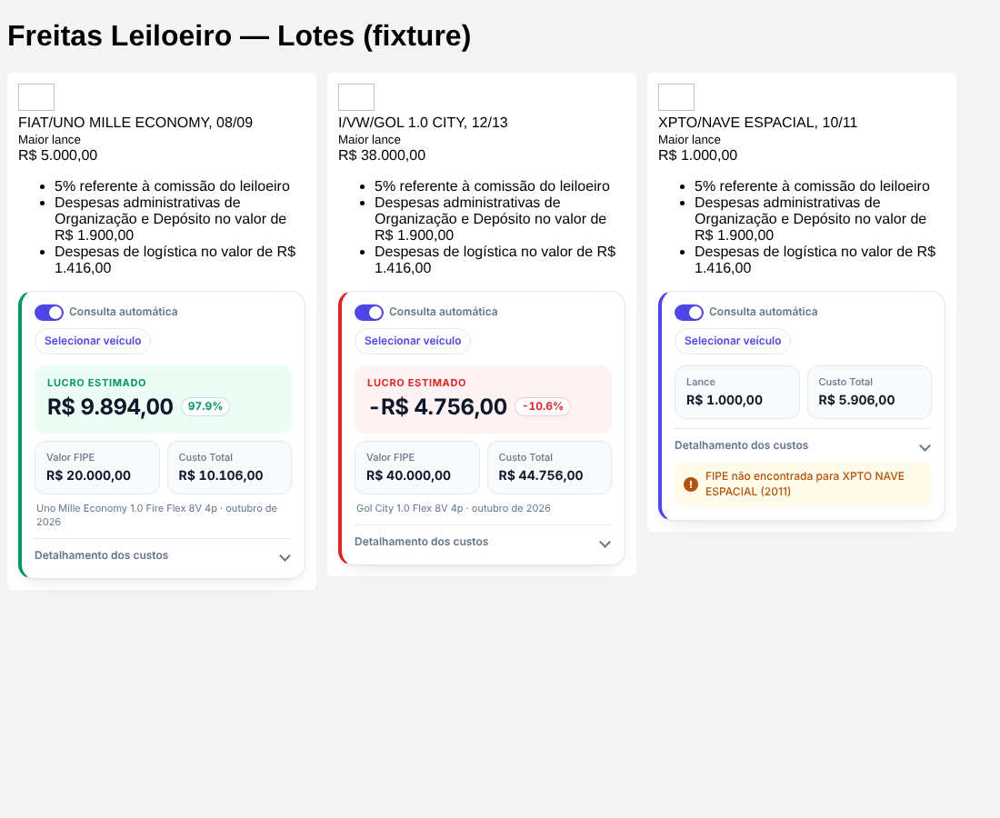
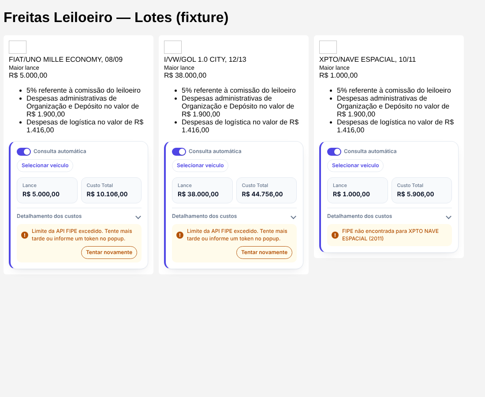
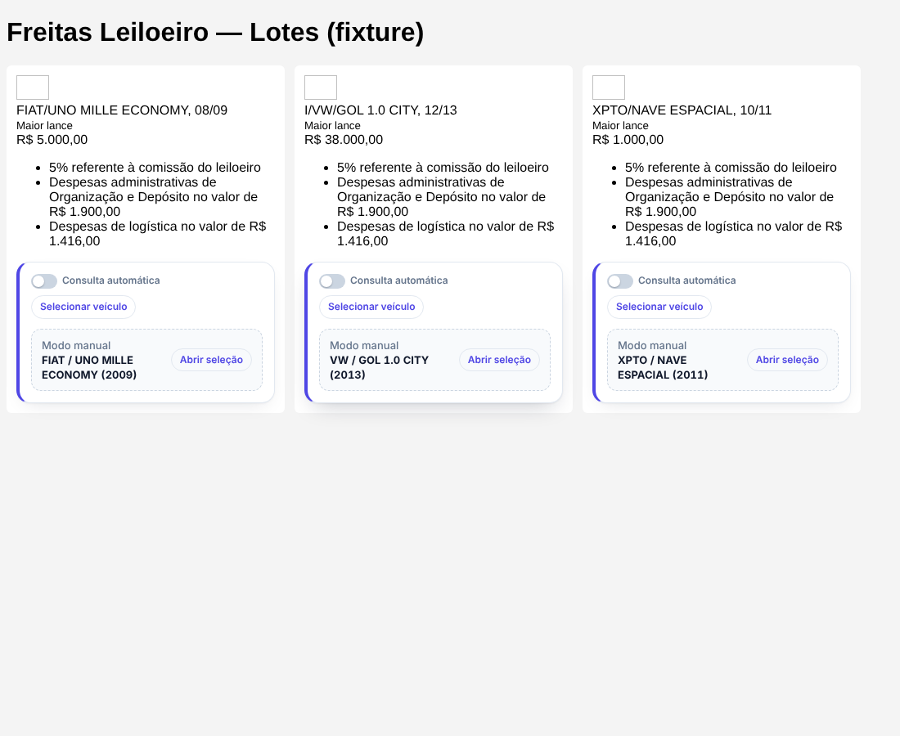
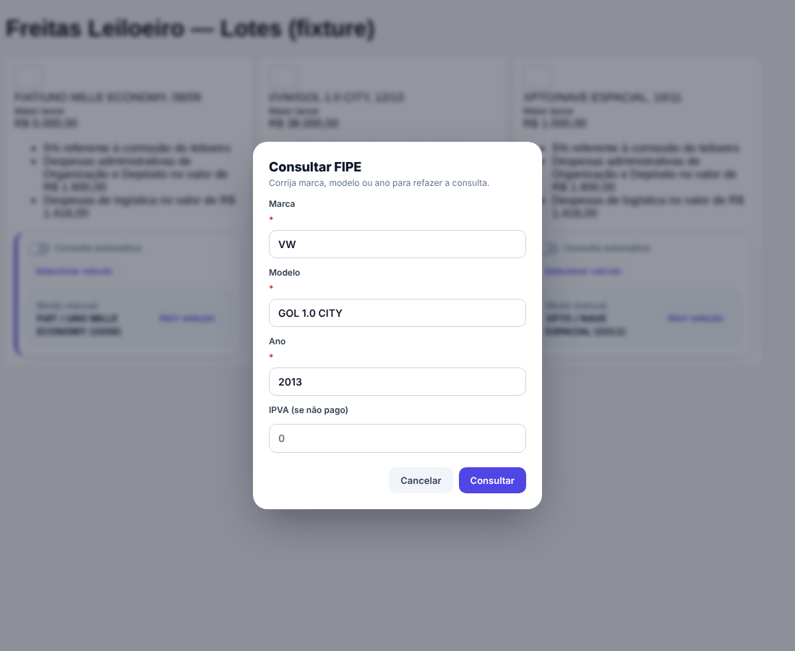
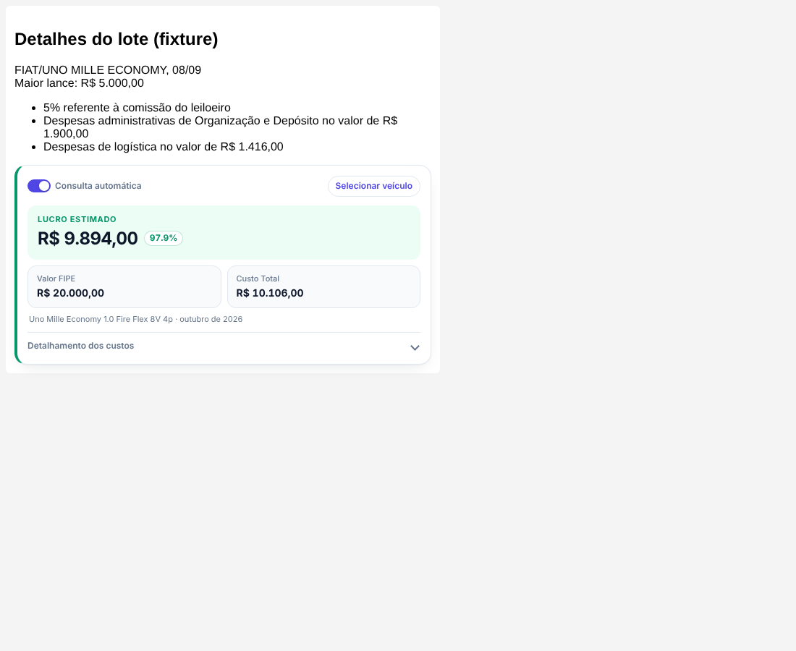
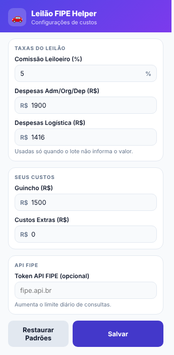

# Leilão FIPE Helper 🚗💨

Extensão para Chrome/Brave/Edge e Firefox (Manifest V3) que consulta a **Tabela FIPE** nos lotes do **Freitas Leiloeiro** e calcula o **custo total e o lucro estimado** de cada veículo.



## ✨ Funcionalidades

- **Consulta FIPE automática** em cada lote (lista e página de detalhes), com o modelo FIPE encontrado e o mês de referência.
- **Custos lidos da própria página** (comissão, despesas administrativas, logística, "IPVA pago"); quando o lote não informa, usa os valores configurados no popup.
- **Cálculo de lucro**: lance + comissão + despesas adm/org/dep + logística + custos extras + ATPV-e + guincho + IPVA (se não pago). Verde = lucro, vermelho = prejuízo.
- **Visual moderno**: o lucro estimado em destaque (valor + %), cartões de *Valor FIPE* e *Custo Total*, e o **detalhamento dos custos recolhível** (o estado aberto/fechado é mantido quando o lance atualiza). Chave liga/desliga para a consulta automática, *skeleton* de carregamento, alertas amarelos para erros, modal com foco visível e respeito a `prefers-reduced-motion`. O popup tem tema claro/escuro automático.
- **Match inteligente**: normaliza acentos, entende abreviações do leilão (`VW`, `GM`, `M.BENZ`, `I/` de importado), mantém cilindrada (`1.0`) e testa as variantes mais parecidas até achar o ano do modelo (±1 ano como fallback). Procura em carros, motos e caminhões.
- **Modo manual**: desligue a "Consulta automática" ou use **Selecionar veículo** para corrigir marca/modelo/ano e informar o IPVA.
- **Erros tratados**: "FIPE não encontrada" (mostra só os custos, sem lucro falso), limite da API excedido e falta de conexão, ambos com **Tentar novamente**.
- **Popup de configurações** com atualização imediata nas abas abertas.

| Detalhamento dos custos | |  |
|---|---|---|
|  | | |

| FIPE não encontrada | Limite da API | Modo manual |
|---|---|---|
|  |  |  |

| Selecionar veículo | Detalhe do lote | Configurações |
|---|---|---|
|  |  |  |

## 🚀 Instalação

```bash
pnpm install
pnpm build        # gera dist/
```

**Chrome / Brave / Edge:** `chrome://extensions` → ative o *Modo do desenvolvedor* → *Carregar sem compactação* → selecione a pasta do projeto.

**Firefox (140+):** `about:debugging#/runtime/this-firefox` → *Carregar extensão temporária…* → selecione `manifest.json`. Ou `pnpm dev` (web-ext).

## ⚙️ Configuração (popup)

| Campo | Padrão | Observação |
|---|---|---|
| Comissão (%) | 5 | Usada só se a página não informar a comissão |
| Despesas Adm/Org/Dep | R$ 1.900,00 | Idem |
| Despesas Logística | R$ 1.416,00 | Idem |
| Guincho | R$ 1.500,00 | Estimativa |
| Custos extras | R$ 0,00 | |
| Token API FIPE | — | Opcional: aumenta o limite da API FIPE v2 ([fipe.api.br](https://fipe.api.br)) |

ATPV-e é fixo em R$ 40,00. O IPVA é informado em **Selecionar veículo** e só entra quando a página não indica "IPVA ... PAGO".

## 🌐 APIs usadas

- **BrasilAPI** (`brasilapi.com.br/api/fipe`): marcas e modelos.
- **FIPE API v2** (`fipe.parallelum.com.br/api/v2`): anos e preço. Sem token o limite é baixo; o resultado é mantido em cache enquanto a aba estiver aberta.

## 🛠️ Desenvolvimento

| Comando | O que faz |
|---|---|
| `pnpm build` / `pnpm watch` | Compila com tsup para `dist/` |
| `pnpm typecheck` | `tsc --noEmit` |
| `pnpm test` | Testes unitários (vitest). `LIVE=1 pnpm test` também consulta as APIs reais |
| `pnpm test:e2e` | Build + Playwright: carrega a extensão num Chromium real e exercita lista, detalhe, popup, erros e modo manual. `LIVE=1` inclui um teste com as APIs reais. Gera os prints em `docs/screenshots/` |
| `pnpm lint:ext` | `web-ext lint` do build |
| `pnpm dev` | Firefox com web-ext |

Estrutura: `src/content_script.ts` (UI nas páginas), `src/fipe_service.ts` (consulta/match), `src/lib.ts` (parse e cálculo), `src/settings.ts` (storage), `src/popup.*`, `e2e/` (fixtures e testes).

## ✅ Homologação

Resultado da última rodada (Chromium 141 headless com a extensão carregada): **30 testes unitários + 11 e2e passando** (+1 e2e e 4 unitários contra as APIs reais com `LIVE=1`). O site do leilão bloqueia acesso automatizado (HTTP 403), então os testes usam páginas-fixture que reproduzem os seletores esperados (`.cardLote-descVeic`, `#hdMaiorLance`, `ul.small.text-secondary`); **valide uma vez em um lote real** após instalar. Firefox foi validado apenas com `web-ext lint` (0 erros).

---
Licença ISC.
