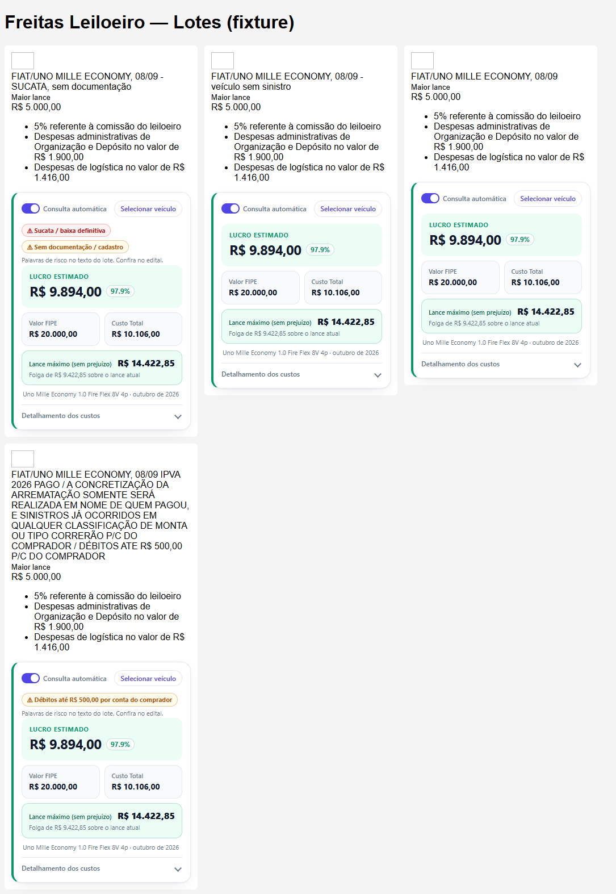
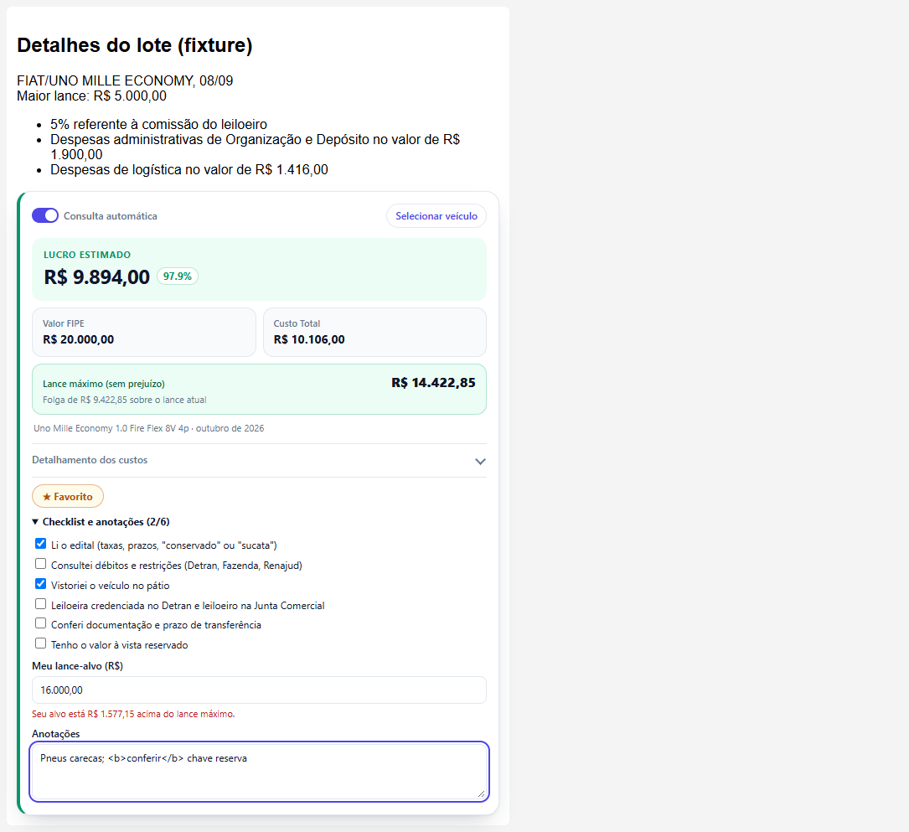
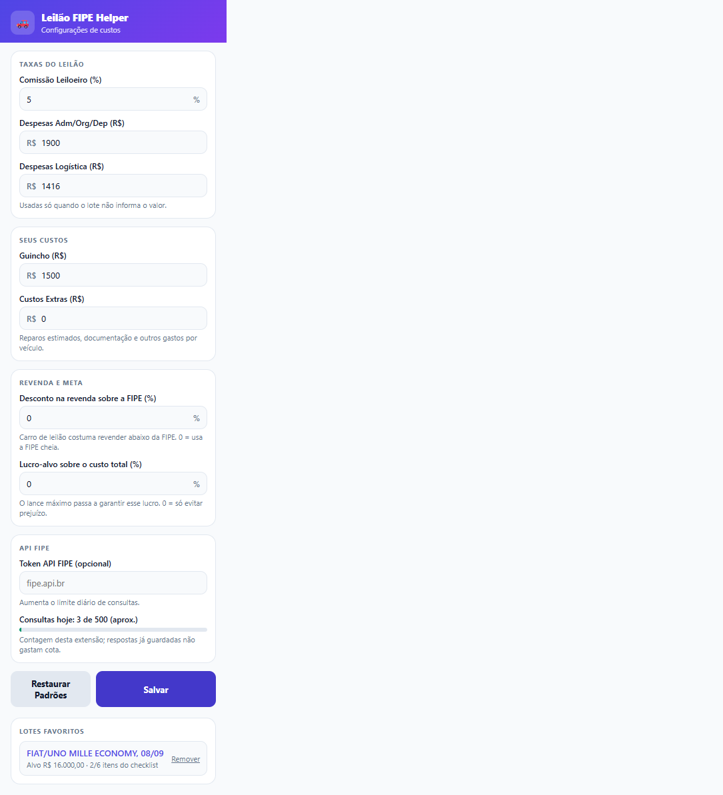

# Leilão FIPE Helper 🚗💨

Extensão para Chrome/Brave/Edge e Firefox (Manifest V3) que consulta a **Tabela FIPE** nos lotes do **Freitas Leiloeiro** e calcula o **custo total e o lucro estimado** de cada veículo.


## ✨ Funcionalidades

- **Consulta FIPE automática** em cada lote (lista e página de detalhes), com o modelo FIPE encontrado e o mês de referência.
- **Custos lidos da própria página** (comissão, despesas administrativas/operacionais, logística, "IPVA pago"); quando o lote não informa, usa os valores configurados no popup.
- **Cálculo de lucro**: lance + comissão + despesas adm/org/dep + logística + custos extras + ATPV-e + guincho + IPVA (se não pago). Verde = lucro, vermelho = prejuízo.
- **Lance máximo recomendado**: o maior lance que ainda não dá prejuízo contra a FIPE, já com comissão e todas as despesas (`(FIPE − custos fixos) / (1 + comissão)`, arredondado para baixo no centavo). Mostra a folga sobre o lance atual ou quanto ele já excede; "Inviável" quando os custos fixos superam a FIPE.
- **Revenda e meta (popup)**: *Desconto na revenda sobre a FIPE* (carro de leilão costuma vender abaixo da tabela) e *Lucro-alvo sobre o custo total*. O lucro passa a ser medido contra `FIPE × (1 − desconto)` e o lance máximo garante a meta: `(revenda / (1 + meta) − custos fixos) / (1 + comissão)`. Reparos entram em *Custos Extras*. Com os dois em 0 nada muda.
- **Alertas de risco**: chips com palavras de risco do texto do lote (sucata, sinistro, alagamento, danos estruturais, sem documentação, Renajud, motor, "débitos até R$ X por conta do comprador"). Frases negadas ("sem sinistro") não contam, e o aviso genérico que o Freitas repete em todos os lotes ("sinistros já ocorridos em qualquer classificação de monta") é ignorado. É um ponteiro para o edital, não um veredito.
- **Meu lote** (página de detalhe): favoritar, **checklist de compra** (edital, débitos e restrições, vistoria, credenciamento da leiloeira, documentação, valor à vista), **lance-alvo** comparado ao lance máximo e anotações. Tudo fica só neste navegador. Os favoritos aparecem no popup.
- **Visual moderno**: o lucro estimado em destaque (valor + %), cartões de *Valor FIPE* e *Custo Total*, e o **detalhamento dos custos recolhível** (o estado aberto/fechado é mantido quando o lance atualiza). Chave liga/desliga para a consulta automática, *skeleton* de carregamento, alertas amarelos para erros, modal com foco visível e respeito a `prefers-reduced-motion`. O popup tem tema claro/escuro automático.
- **Match inteligente**: normaliza acentos, entende abreviações do leilão (`VW`, `GM`, `M.BENZ`, `I/` de importado), mantém cilindrada (`1.0`) e testa as variantes mais parecidas até achar o ano do modelo (±1 ano como fallback). Procura em carros, motos e caminhões.
- **Modo manual / Selecionar veículo**: desligue a "Consulta automática" ou clique em **Selecionar veículo** para escolher o veículo direto na tabela FIPE: **categoria** (carros, motos, caminhões) → **marca** → **modelo** (busca com filtro por vários termos, sem acento e sem diferenciar maiúsculas; mostra até 50 resultados e informa o total) → **ano** (os anos reais daquele modelo). Já abre preenchido com o que foi detectado no lote, funciona só com o teclado (↑ ↓ Home End Enter Esc, foco preso no diálogo) e a consulta usa os códigos FIPE exatos. Também informa o IPVA.
- **Erros tratados**: "FIPE não encontrada" (mostra só os custos, sem lucro falso), limite da API excedido e falta de conexão, ambos com **Tentar novamente**.
- **Popup de configurações** com atualização imediata nas abas abertas.

**Detalhamento dos custos** (recolhível):


| Alertas de risco | Meu lote | Favoritos e cota (popup) |
|---|---|---|
|  |  |  |

| FIPE não encontrada | Limite da API | Modo manual |
|---|---|---|
|  |  |  |

| Selecionar veículo | Detalhe do lote | Configurações |
|---|---|---|
|  |  |  |

## 🚀 Instalação

Requisitos: Node.js 22 (versão usada no CI) e pnpm 10 (`packageManager` do `package.json`).

```bash
pnpm install
pnpm build        # gera dist/
```

**Chrome / Brave / Edge:** `chrome://extensions` → ative o *Modo do desenvolvedor* → *Carregar sem compactação* → selecione a pasta do projeto.

**Firefox (140+):** `about:debugging#/runtime/this-firefox` → *Carregar extensão temporária…* → selecione `manifest.json`. Ou `pnpm dev` (web-ext).

## ⚙️ Configuração (popup)

| Campo | Padrão | Observação |
|---|---|---|
| Comissão (%) | 5 | Usada só se a página não informar a comissão |
| Despesas Adm/Org/Dep | R$ 1.900,00 | Idem |
| Despesas Logística | R$ 1.416,00 | Idem |
| Guincho | R$ 1.500,00 | Estimativa |
| Custos extras | R$ 0,00 | |
| Token API FIPE | — | Opcional: aumenta o limite da API FIPE v2 ([fipe.api.br](https://fipe.api.br)) |

ATPV-e é fixo em R$ 40,00. O IPVA é informado em **Selecionar veículo** e só entra quando a página não indica "IPVA ... PAGO".

## 🌐 APIs usadas

- **BrasilAPI** (`brasilapi.com.br/api/fipe`): marcas e modelos.
- **FIPE API v2** (`fipe.parallelum.com.br/api/v2`): anos e preço. Sem token o limite é de **500 requisições por dia** (1.000 com token gratuito de [fipe.api.br](https://fipe.api.br)).
  - **Cache local** (`chrome.storage.local`, só respostas da FIPE v2): a tabela FIPE é mensal, então anos e preços valem **até a FIPE publicar a próxima tabela**. A extensão pergunta `/references` (no máximo 2 vezes por dia) para saber qual é a atual; se essa checagem falhar, vale uma janela de 3 dias. Sobrevive a recargas e a novas abas.
  - **Contador de cota** no popup: quantas consultas a extensão fez hoje (aproximado) e aviso para cadastrar token perto do limite.
  - **429**: a extensão usa a cópia guardada (até 45 dias) em vez de mostrar erro, e pausa novas chamadas por 5 minutos (por cota: com token é outra cota). **Tentar novamente** ignora a pausa.

## 🛠️ Desenvolvimento

| Comando | O que faz |
|---|---|
| `pnpm build` / `pnpm watch` | Compila com tsup para `dist/` |
| `pnpm typecheck` | `tsc --noEmit` |
| `pnpm test` | Testes unitários (vitest). `LIVE=1 pnpm test` também consulta as APIs reais |
| `pnpm test:e2e` | Build + Playwright: carrega a extensão num Chromium real e exercita lista, detalhe, popup, erros, seletor de veículo e lance máximo. `LIVE=1` inclui um teste com as APIs reais. Gera os prints em `docs/screenshots/` |
| `pnpm lint:ext` | `web-ext lint` do build |
| `pnpm dev` | Firefox com web-ext |

Estrutura: `src/content_script.ts` (UI nas páginas), `src/vehicle_picker.ts` + `src/combobox.ts` + `src/search.ts` (seletor de veículo), `src/fipe_service.ts` (consulta/match/catálogo), `src/fipe_http.ts` + `src/persistent_cache.ts` (HTTP, cache persistente e pausa no 429), `src/lib.ts` (parse e cálculo), `src/settings.ts` (storage), `src/popup.*`, `e2e/` (fixtures e testes).

## 🔒 Gates de CI

| Workflow | O que checa |
|---|---|
| `CI` (`ci.yml`) | Node 22, `pnpm install --frozen-lockfile`, `pnpm typecheck`, `pnpm test`, `pnpm build`, `pnpm lint:ext` e o e2e do Playwright com a extensão no Chromium |
| `Validate` (`validate.yml`) | Reutiliza `juninmd/base-actions` (`reusable-validate.yml`): validação do PR (lint apenas como aviso) e auditoria de dependências, nível `high` bloqueante |
| `Security Scan` (`security.yml`) | Gitleaks via `juninmd/base-actions` (`reusable-security-scan.yml`), em push para `main`/`master` |
| `Release Drafter` (`release-drafter.yml`) | Mantém o rascunho de release atualizado; não bloqueia |

## ✅ Homologação

Última rodada (Chromium do Playwright, headless, com a extensão carregada): **111 testes unitários + 24 e2e passando** (+4 unitários e 1 e2e contra as APIs reais com `LIVE=1`). No Windows use `CHROME_PATH` apontando para o Chromium do Playwright.

**Lotes reais** (leilão 8120, lotes 3, 4 e 8, página de detalhe, APIs FIPE reais, 3 execuções completas): 87 verificações, todas OK. Cobrem lance/comissão/despesas lidos da própria página, aritmética do detalhamento e do lance máximo recalculada de forma independente, ausência de deriva em 10 s, resultado idêntico em contexto novo, seletor (pré-preenchimento, busca, teclado, categoria, Esc) em 1280 px e 375 px. Dois defeitos só apareceram aí e estão cobertos por teste: "Despesas **operacionais**" (o site usa essa palavra em alguns leilões) e a extensão ler o próprio painel como lance quando o lote não tem lances ("Aguardando lances": vale o *Lance Inicial*). Firefox: `web-ext lint` com 0 erros.

**Cache, alertas e "Meu lote" em lotes reais** (lotes 1, 2, 3, 4, 6 e 8 do leilão 8120, APIs FIPE reais): 38 verificações, todas OK. Cobrem a tabela de referência real aprendida, respostas gravadas e etiquetadas com ela, contador do popup igual às requisições reais, **revisita dos 3 lotes com 0 chamadas à API**, favorito/alvo/anotação que sobrevivem ao recarregar, lucro e lance máximo com revenda e meta recalculados de forma independente. Dois falsos positivos só apareceram nas páginas reais e estão cobertos por teste: o aviso que o Freitas repete em todos os lotes ("sinistros já ocorridos em qualquer classificação de monta", inclusive a variante que termina uma lista de substantivos) fazia **todo lote** ganhar o chip "Sinistro".

---
Licença ISC.
